# OmniBank Local 🏦

<p align="center">
  <a href="#-français">Français</a> • 
  <a href="#-english">English</a>
</p>
---

# 🇫🇷[](https://github.com/Aschefr/OmniBank-Local/releases)
[](https://amify-studio.fr)
[](#)

**OmniBank Local** est une solution de gestion de finances personnelles et associatives ultra-privée, conçue pour ceux qui exigent un contrôle total sur vos données. Alliant la puissance d'un tableur à l'intelligence d'une IA locale, elle transforme votre gestion financière en une expérience fluide et sécurisée.

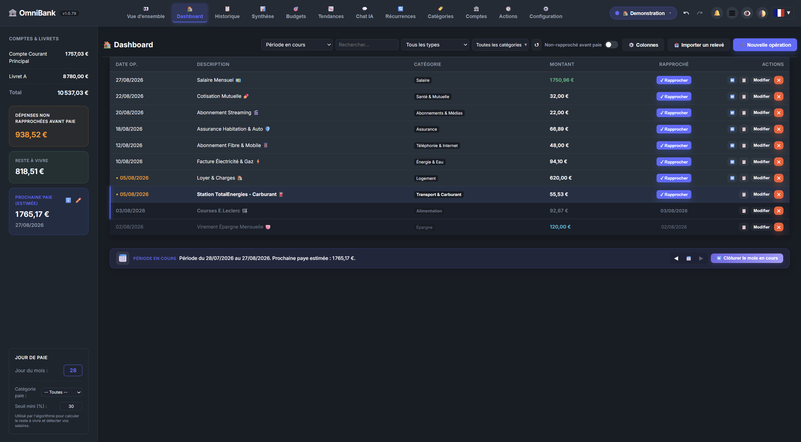

> [!CAUTION]
> **Avertissement** : La sécurité du code n'a pas fait l'objet d'un audit indépendant. Utilisez cette application à vos propres risques et uniquement dans un environnement local sécurisé.

> [!TIP]
> **Chiffrement du disque recommandé** : La base de données SQLite stocke vos données financières en clair sur le disque. Pour une protection optimale, activez le chiffrement intégral de votre disque (BitLocker sous Windows, LUKS sous Linux, FileVault sous macOS).

---

## 🌟 Pourquoi OmniBank ?

*   **0 Cloud, 100% Offline** : Vos données restent physiquement sur votre machine. Aucune télémétrie, aucun tracking.
*   **IA Locale & RAG** : Vos transactions sont vectorisées en local pour permettre un dialogue fluide avec votre historique financier via **Ollama**.
*   **Contrôle Total des Catégories** : Règles automatiques, détection intelligente de patterns et classification assistée.
*   **Visualisations Riches** : Graphiques financiers clairs (Chart.js) et tableau virtuel pour les historiques volumineux.
*   **Conçu pour Durer** : Base SQLite standard et exports universels (CSV, JSON).

---

## ✨ Fonctionnalités Clés

### 🏗️ Configuration Simplifiée (Setup Wizard)
Dès le premier lancement, un **Assistant d'Initialisation** vous guide pour configurer vos comptes, vos préférences et connecter votre instance Ollama.

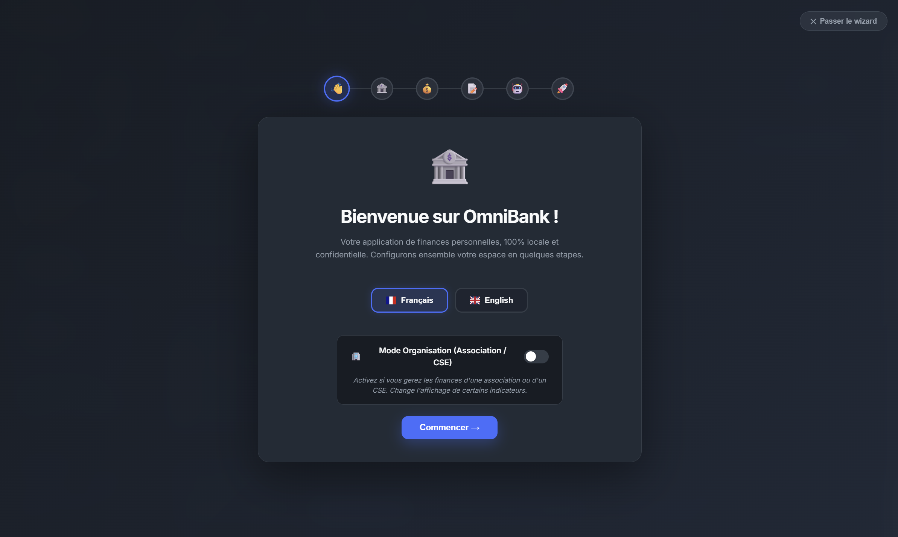

### 📈 Analytique & Gestion Quotidienne
*   **Cockpit & Journal** : Le Cockpit résume votre cycle en un coup d'œil (reste à vivre, rythme de dépense, patrimoine net), le Journal liste les opérations à saisir et rapprocher ; moyennes et top des dépenses sont dans Tendances.
*   **Historique Virtualisé** : Gérez des milliers de transactions avec une fluidité parfaite grâce au rendu ultra-rapide.
*   **Rapprochement Intelligent** : Un système visuel pour pointer vos opérations. Comparez d'un coup d'œil vos relevés bancaires (avant) et votre comptabilité propre (après).

| Saisie d'opération | Historique | Rapprochement |
| :---: | :---: | :---: |
| 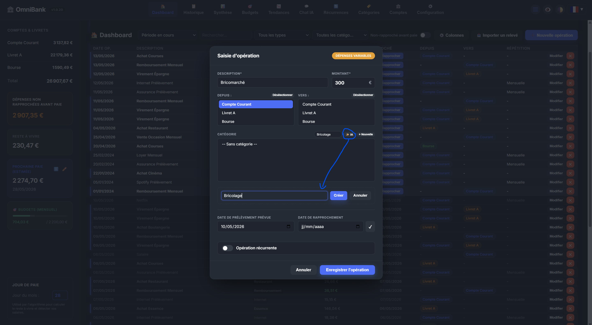 | 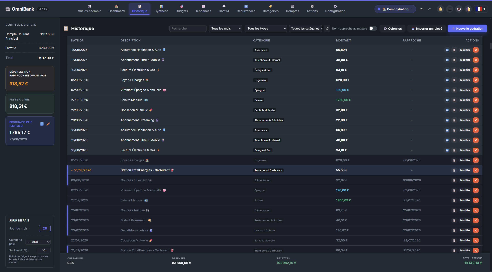 | 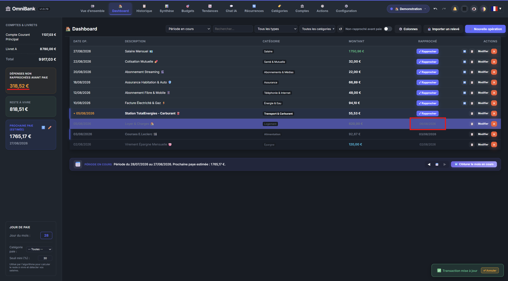 |

### 🎯 Budget & Enveloppes
Suivez vos dépenses par catégories ou par projets avec un système d'enveloppes visuel. L'IA peut même vous suggérer des budgets basés sur vos habitudes.

| Vue Budget | Détail Budget | Suggestions IA |
| :---: | :---: | :---: |
| 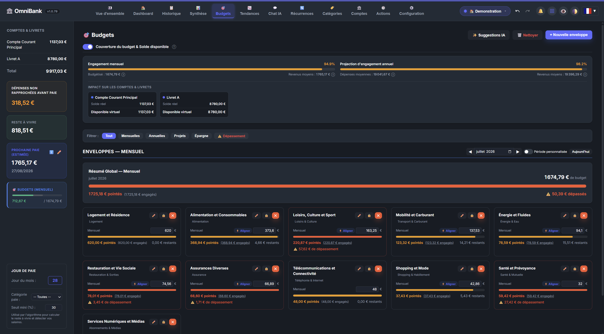 | 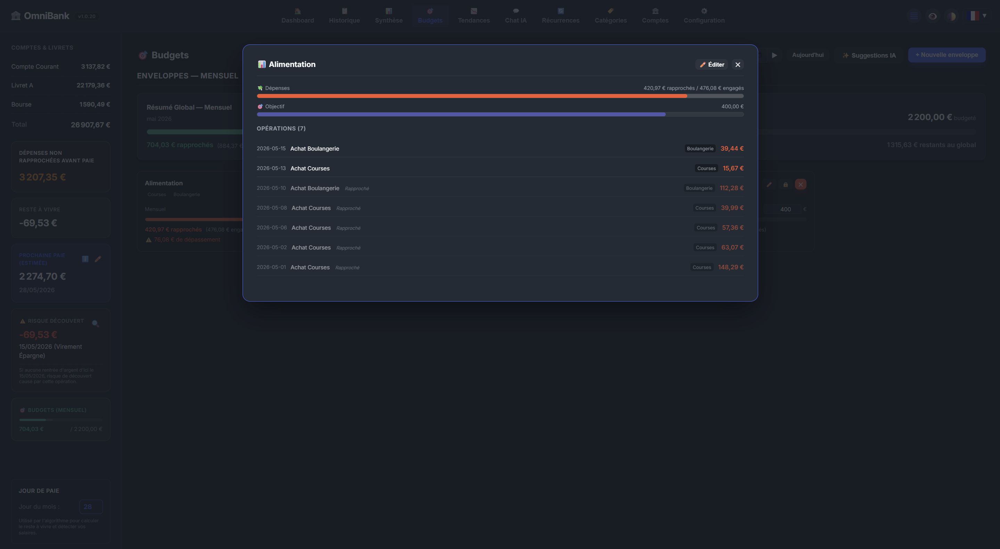 | 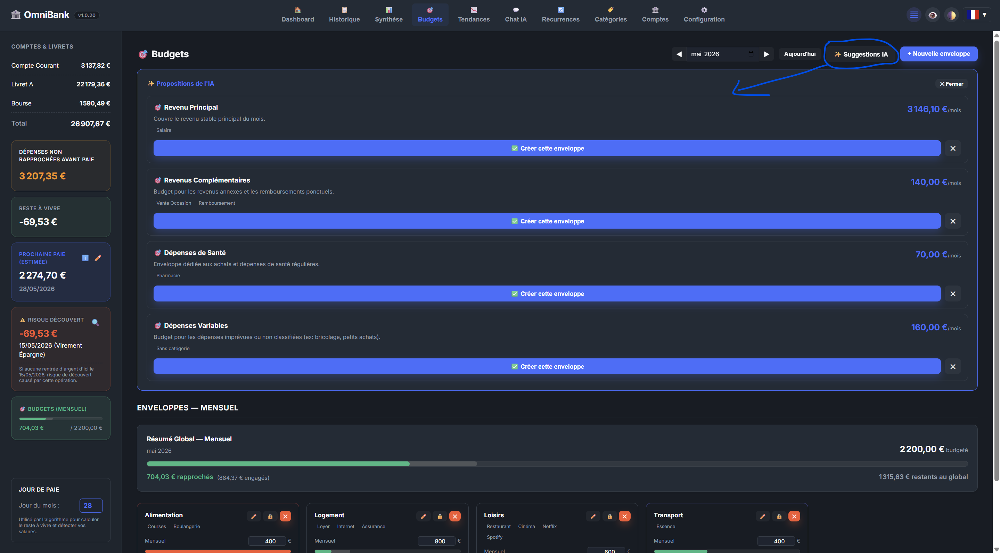 |

### 🤖 Intelligence Artificielle Locale
Interagissez avec votre assistant financier personnel via Ollama. Grâce au RAG (Retrieval-Augmented Generation), l'IA accède à vos données pour répondre précisément. Elle peut même vous soumettre des **propositions d'actions interactives** directement dans le chat.

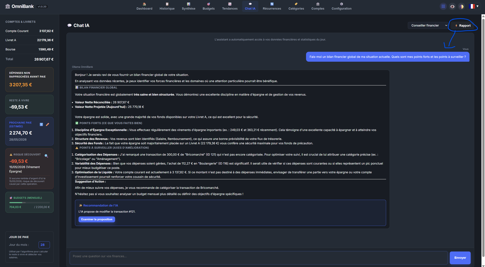

### 📊 Synthèse & Tendances
Visualisez l'évolution de votre patrimoine et générez des **rapports PDF haute fidélité**, parfaits pour un suivi comptable rigoureux ou un partage sécurisé.

| Synthèse | Tendances | Export PDF |
| :---: | :---: | :---: |
| 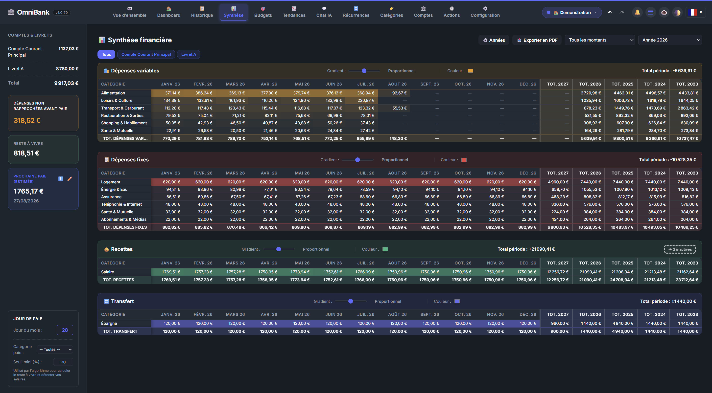 | 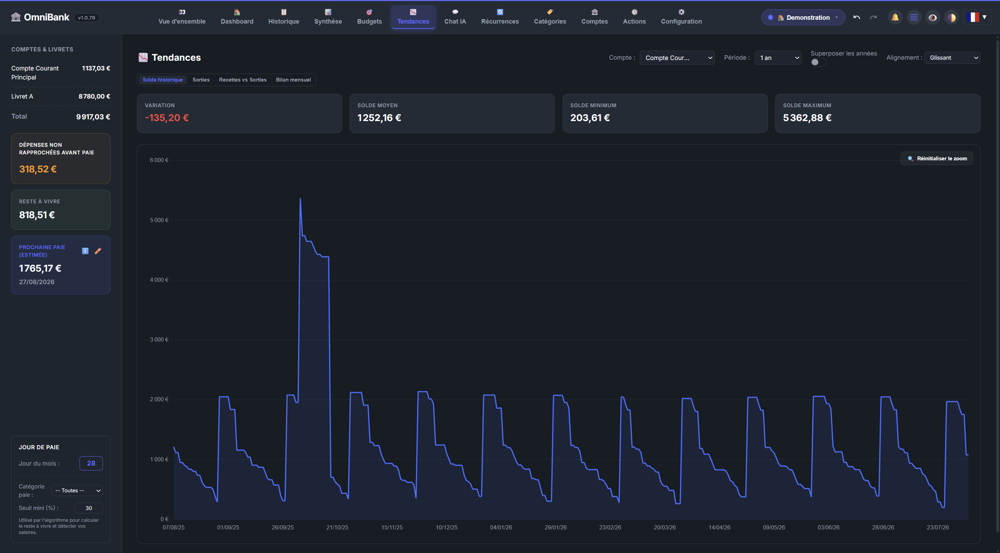 | 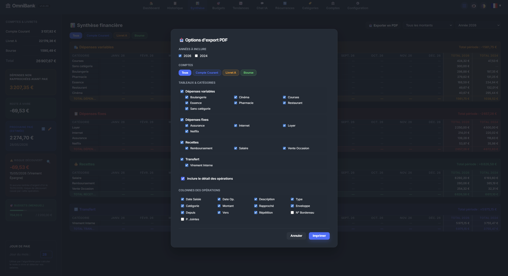 |

### 🛠️ Administration & Personnalisation
Prenez le contrôle total de votre structure financière grâce à des outils de gestion flexibles.

| Comptes | Catégories | Récurrences | Configuration |
| :---: | :---: | :---: | :---: |
| 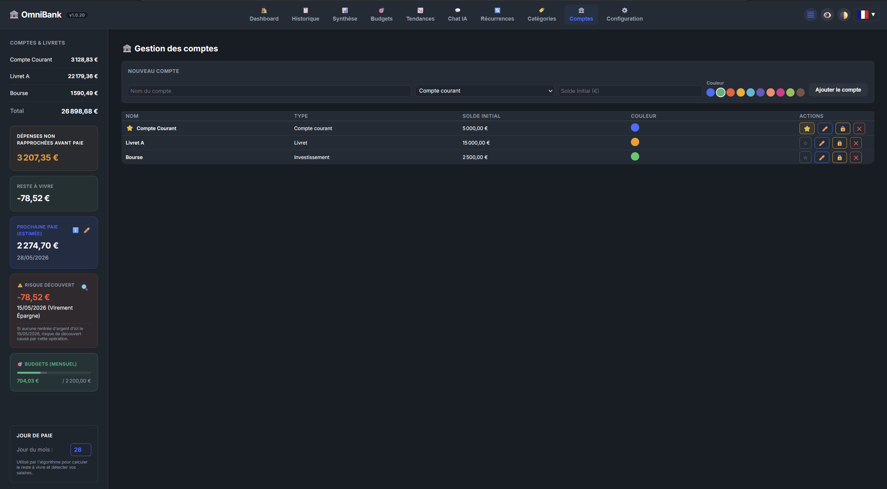 | 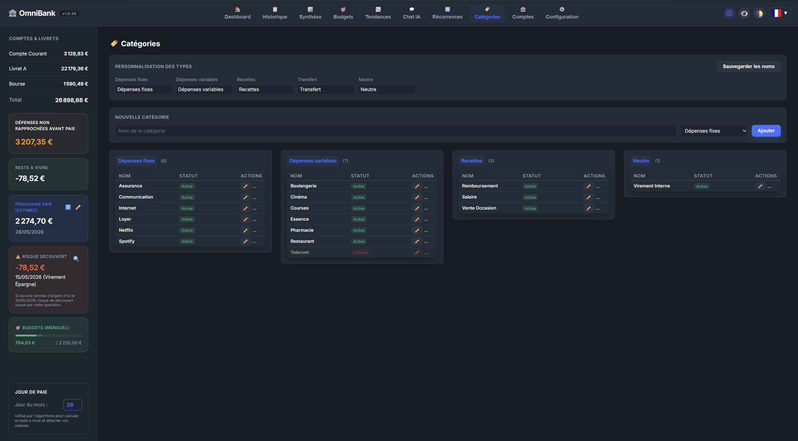 | 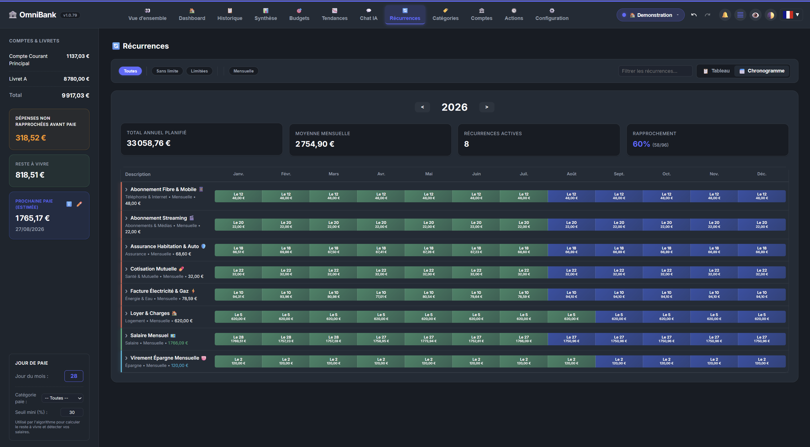 | 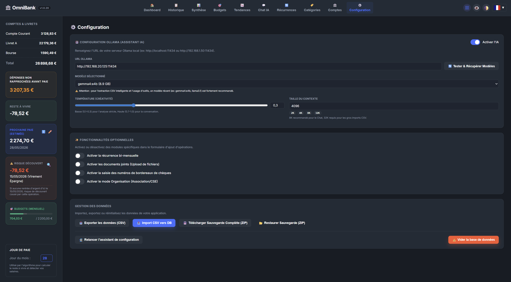 |

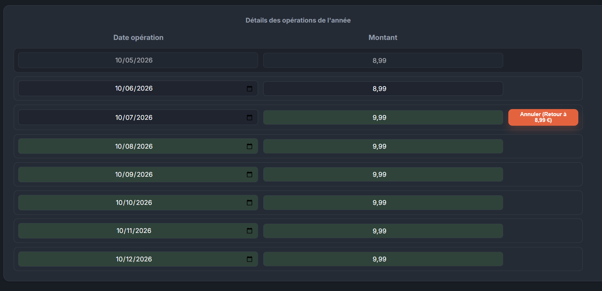

---

## 🏢 Mode Organisation (Associations / CSE)

OmniBank propose un **mode organisation** conçu pour les associations, comités d'entreprise (CSE) et petites structures ayant besoin d'un suivi multi-utilisateur.

*   **👥 Multi-utilisateur sans mot de passe** : Chaque membre (trésorier, adjoint, secrétaire…) sélectionne son profil au lancement.
*   **📋 Audit intégré** : Chaque opération enregistre automatiquement qui l'a créée et qui l'a modifiée en dernier.
*   **🔑 Licence requise** : L'activation du mode organisation nécessite une clé de licence.

> Le Mode Organisation est momentanément hors de la vente, pour une durée indéterminée. Si vous disposez déjà d'une licence, saisissez votre clé dans la Configuration.

---

## 🚀 Installation

### 🖥️ Windows (Recommandé)
Téléchargez le dernier installateur `.msi` depuis la page des [Releases](https://github.com/Aschefr/OmniBank-Local/releases).

### 🐳 Docker
Image prête à l'emploi (amd64 et arm64), par exemple pour Unraid ou un NAS : `aschefr/omnibank-local:latest`, port `8434`, données dans le volume `/app/data`.

Depuis les sources :
```bash
docker-compose up -d --build
```
Accédez à l'interface sur `http://localhost:8434`. Le `docker-compose.yml` n'écoute que sur la machine locale : pour y accéder depuis un autre appareil du réseau (téléphone, autre PC), lancez-le avec `OMNIBANK_BIND_IP=0.0.0.0`.

---

## 🛠 Stack Technique

*   **Backend** : Python (FastAPI), SQLAlchemy, Pandas.
*   **Frontend** : HTML5/CSS3 (Vanilla), JavaScript, Chart.js.
*   **Desktop** : Tauri (Wrapper Rust).
*   **IA** : Ollama (Support Texte & Vision).

## 🆕 Nouveautés (v1.3.0)

* **🎛️ Cockpit en Page d'Accueil & Navigation Repensée** : le Cockpit devient la page d'accueil, l'ancien Dashboard devient « Journal » et le Tableau de bord complet est retiré (les anciens liens ouvrent le Cockpit). Carte patrimoine net, jauge de cadence qui compte les dépenses dès qu'elles ont lieu, et menu « Plus » au lieu du défilement horizontal des onglets.
* **📱 Refonte Mobile** : barre d'onglets en bas, cartes d'opération compactes, formulaire plein écran (montant d'abord) et tableaux lisibles sur téléphone (Récurrences, Synthèse, Tendances).
* **🤖 Assistant IA Repensé** : réponses plus courtes et fiables, actions proposées avant d'être préparées, personnalité et guide de l'interface modifiables, aperçu du prompt final, questions de démarrage et mémoire des longues conversations (résumé automatique sans bloquer l'application).
* **🔐 Code PIN Appliqué par le Serveur & Sauvegardes Chiffrées** : un profil protégé exige un déverrouillage (essais limités, code de récupération) et ses données sont chiffrées dans les sauvegardes globales.
* **⚙️ Configuration Réorganisée** : six sections claires, actions sensibles regroupées dans une « Zone de danger » repliée, page deux fois plus courte sur téléphone.

## 📦 Historique Récent (v1.2.11)

* **⚡ Navigation Instantanée & Caching SWR Multi-Vues** : Rendu instantané et non-bloquant des vues (Dashboard, Historique, Synthèse, Budgets, Tendances, Récurrences, Simulateur) via le pattern Stale-While-Revalidate (SWR) et parallélisation des requêtes, abaissant les transitions sous 380ms.
* **⏱️ Filtrage Côté Serveur & Fenêtrage Scoped (Timeline & Récurrences)** : Réduction de plus de 90% des charges utiles de transactions grâce au fenêtrage ciblé (`timeline_window` et `has_recurrence`), avec bascule transparente vers l'historique complet à la demande.
* **🎯 Cadence Financière Serveur & Parité de Rendu Stricte (Navigation vs F5)** : Nouveau endpoint optimisé `/api/stats/rhythm` avec calcul des moyennes IQR sans latence client et résolution préalable des comptes actifs pour une parité 100% stricte entre sessions et démarrage à froid (Zero F5).
* **🤖 Fenêtre d'Opération Unifiée & Rapprochement Prévisionnel Auto-Pilote** : Modale unifiée permettant de lier n'importe quelle opération bancaire à une prévision comptable avec sélection chronologique, défilement automatique, traçabilité des décisions et déliaison bidirectionnelle réversible.

> 📖 Pour l'historique complet et détaillé de toutes les versions antérieures, consultez le **[CHANGELOG.md](CHANGELOG.md)**.

---

# 🇺🇸 English

[](https://github.com/Aschefr/OmniBank-Local/releases)
[](https://amify-studio.fr)
[](#)

**OmniBank Local** is an ultra-private personal and organizational finance management solution, designed for those who demand total control over their data. Combining spreadsheet-like power with local AI intelligence, it transforms financial management into a smooth and secure experience.


> [!CAUTION]
> **Disclaimer**: The code's security has not undergone any independent audit. Use this application at your own risk and only in a secure local environment.

---

## 🌟 Why OmniBank?

*   **🔒 Absolute Privacy (Zero Cloud)**: Your financial data never leaves your machine. Everything is stored locally in a SQLite database.
*   **🤖 Local AI Assistant (Ollama)**: Chat with your finances in natural language. Smart categorization, trend forecasting, and tailored advice without compromising privacy.
*   **⚡ Extreme Performance**: Virtualized table rendering to handle tens of thousands of transactions seamlessly.
*   **🎯 Envelope Budgeting**: Intuitive visual envelopes for ongoing spending and savings goals.

---

## ✨ Key Features

### 🏗️ Simplified Setup (Setup Wizard)
From the very first launch, an **Initialization Assistant** guides you through configuring your accounts, preferences, and connecting your Ollama instance.


### 📈 Analytics & Daily Management
*   **Cockpit, Dashboard & Ledger**: the Cockpit sums up your cycle at a glance (remaining budget, spending pace), the Dashboard details balances and averages, the Ledger lists the operations to enter and reconcile.
*   **Virtualized History**: Manage thousands of transactions with perfect fluidity thanks to ultra-fast rendering.
*   **Smart Reconciliation**: A visual system to check your operations. Compare bank statements (before) and your clean accounting (after) at a glance.

| Transaction entry | History | Reconciliation |
| :---: | :---: | :---: |
|  |  |  |

### 🎯 Budget & Envelopes
Suivez vos dépenses par catégories ou par projets avec un système d'enveloppes visuel. L'IA peut même vous suggérer des budgets basés sur vos habitudes.

| Vue Budget | Détail Budget | Suggestions IA |
| :---: | :---: | :---: |
|  |  |  |

### 🤖 Local AI Assistant
Interact with your personal financial assistant via Ollama. Thanks to RAG (Retrieval-Augmented Generation), the AI accesses your data to answer accurately. It can even propose **interactive action cards** directly in the chat.


### 📊 Analytics & Trends
Visualize your financial trajectory and export **high-fidelity PDF reports**, perfect for strict accounting follow-up or secure sharing.

| Monthly Analytics | Long-Term Trends | PDF Export |
| :---: | :---: | :---: |
|  |  |  |

### 🛠️ Administration & Customization
Take full control over your financial structure with flexible management tools.

| Accounts | Categories | Recurrences | Settings |
| :---: | :---: | :---: | :---: |
|  |  |  |  |


---

## 🏢 Organisation Mode (Associations / Works Councils)

OmniBank includes an **organization mode** designed for non-profits, sports clubs, works councils (CSE), and small organizations requiring multi-user access.

*   **👥 Multi-user without passwords**: Every member (treasurer, deputy, secretary…) selects their profile at launch.
*   **📋 Built-in audit trail**: Every transaction automatically logs who created it and who modified it last.
*   **🔑 License required**: Activating Organization Mode requires a valid license key.

> Organisation Mode is temporarily off sale, for an indefinite period. If you already have a license, enter your key in Configuration.

---

## 🚀 Installation

### 🖥️ Windows (Recommended)
Download the latest `.msi` installer from the [Releases](https://github.com/Aschefr/OmniBank-Local/releases) page.

### 🐳 Docker
Ready-to-use image (amd64 and arm64), for example on Unraid or a NAS: `aschefr/omnibank-local:latest`, port `8434`, data in the `/app/data` volume.

From source:
```bash
docker-compose up -d --build
```
Access the interface at `http://localhost:8434`. The `docker-compose.yml` only listens on the local machine: to reach it from another device on your network (phone, other PC), start it with `OMNIBANK_BIND_IP=0.0.0.0`.

---

## 🛠 Technical Stack

*   **Backend**: Python (FastAPI), SQLAlchemy, Pandas.
*   **Frontend**: HTML5/CSS3 (Vanilla), JavaScript, Chart.js.
*   **Desktop**: Tauri (Rust Wrapper).
*   **AI**: Ollama (Text & Vision Support).

## 🆕 What's New (v1.3.0)

* **🎛️ Cockpit as Home Page & Reworked Navigation**: The Cockpit is now the landing page, the former Dashboard is renamed "Journal" and the full "Tableau de bord" is retired (old links open the Cockpit). Net worth card, a pace gauge that counts spending as soon as it happens, and a "More" menu instead of sideways-scrolling tabs.
* **📱 Mobile Redesign**: Bottom tab bar, compact operation cards, a full-screen operation form (amount first) and tables that read well on phones (Recurrences, Analytics, Trends).
* **🤖 Reworked AI Assistant**: Shorter, more reliable answers, actions offered before being prepared, editable personality and interface guide, a final prompt preview, starter questions and memory for long conversations (automatic summary without freezing the app).
* **🔐 Server-Enforced Profile PIN & Encrypted Backups**: A protected profile must be unlocked (rate-limited, with a recovery code), and its data is encrypted in global backups.
* **⚙️ Reorganised Configuration**: Six clear sections, sensitive actions grouped in a folded "Danger zone", and a page half as long on phones.

## 📦 Recent History (v1.2.11)

* **⚡ Instant View Navigation & Multi-View SWR Caching**: Non-blocking instant view rendering across Dashboard, Operations History, Analytics, Budgets, Trends, Recurrences, and Simulator using Stale-While-Revalidate (SWR) caching and parallel fetching, dropping screen transitions below 380ms.
* **⏱️ Server-Side Targeted Windowing (Timeline & Recurrences)**: Drops transaction payload by over 90% with server-side windowing (`timeline_window` and `has_recurrence`), while providing seamless, on-demand fallback to full history for older cycles.
* **🎯 Server-Side Financial Rhythm & Strict Render Parity (Navigation vs F5)**: Dedicated cached `/api/stats/rhythm` endpoint computing robust IQR averages in under 1ms with pre-resolved active account state, guaranteeing 100% strict equality between navigation and cold reloads (Zero F5).
* **🤖 Unified Operation Modal & Auto-Pilot Forecast Linking**: Unified editing dialog to directly link bank transactions to accounting forecasts with chronological candidate matching, auto-scrolling, human override tracking, and reversible bi-directional unlinking.

> 📖 For the full, detailed history of all previous releases, see the **[CHANGELOG.md](CHANGELOG.md)**.

### 🐍 Développement Local / Local Development

1. `python -m venv venv`
2. `.\venv\Scripts\activate`
3. `pip install -r requirements-dev.txt`
4. `uvicorn app.main:app --host 127.0.0.1 --port 8434 --reload`

## 📝 Licence / License

Ce projet est disponible en accès partagé (**Source-Available**) sous la licence propriétaire d'Amify Studio.

* **Usage Personnel / Personal Use** : Gratuit et autorisé pour un usage strictement individuel et privé. / Free and permitted for strictly individual and private use.
* **Usage Organisation / Organizational Use** : L'utilisation collective, par une association (Loi 1901, CSE) ou une entreprise (y compris l'activation du "Mode Organisation") requiert l'acquisition d'une clé de licence commerciale. / Any group, non-profit, or corporate use (including enabling "Organisation Mode") requires a commercial license key.
* **Détails / Details** : Voir le fichier [LICENSE](LICENSE) pour les termes complets. / See the [LICENSE](LICENSE) file for full terms.
