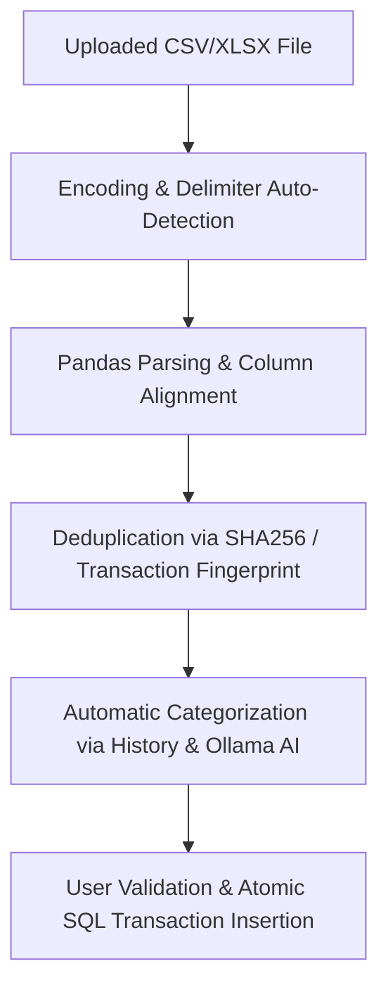
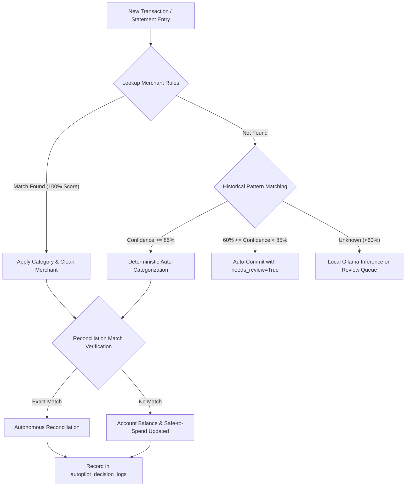

# ⚙️ Technical Pipelines & Internal Mechanisms Analysis

This document provides a deep-dive technical analysis of OmniBank Local's source code, internal mechanisms, and data processing pipelines—from first-launch initialization to database backup and restoration.

---

## 🔁 Pipeline 1: First Launch & SQL Database Seeding

### 1. Initialization State Detection
When the FastAPI server starts (`app/main.py`), the initialization function checks whether the SQLite database exists and contains active bank accounts:
- SQLite File: `omnibank.db` (managed by SQLAlchemy via `app/database.py`).
- If no accounts are found in the `accounts` table, the API returns `setup_required = True`.
- The Vanilla JS frontend (`static/js/app.js`) intercepts this status and displays the full-screen **Setup Wizard** (`static/js/views/setup_wizard.js`).

### 2. Default Data Seeding (`app/init_data.py`)
Upon completing the Setup Wizard:
1. **Initial Account Creation**: The API invokes `POST /api/setup/initialize` to create the first account.
2. **Category Seeding**: The function `seed_initial_categories(db)` in `app/init_data.py` inserts the default tree of income and expense categories (Groceries, Housing, Transport, Entertainment, Healthcare, Salary, etc.) with custom icons and colors.
3. **Base Configuration**: The `config` table is initialized with default language (`fr` or `en`), theme (`dark` or `light`), and Ollama AI settings.

---

## 📥 Pipeline 2: CSV / XLSX Parsing, Categorization & Deduplication

The statement import pipeline (`app/routers/csv_parser.py`, `app/services/csv_service.py`, and `static/js/views/import_wizard.js`) executes across 4 phases:

### Phase A: Automatic Format Detection
- **Encoding**: Sample analysis to distinguish `UTF-8`, `UTF-8-SIG`, and `ISO-8859-1` / `Windows-1252`.
- **Delimiter**: Statistical frequency count of delimiters (`;`, `,`, `\t`) across initial rows.
- **Number Format**: Automatic handling of European decimal commas (`1234,56`) and Anglo-Saxon decimal points (`1234.56`), as well as multi-column Debit / Credit merging with debit sign negation.

### Phase B: Transaction Deduplication
To prevent double-counting during overlapping statement imports:
- For each row, the algorithm generates a unique fingerprint based on: `Account_ID + Date + Amount + Cleaned Description`.
- The API checks if a transaction with identical characteristics already exists in the SQLite database. If found, it is flagged as a **"Probable Duplicate"** in the wizard and unchecked by default.

### Phase C: Automatic Categorization
- `csv_service.py` matches description keywords against past user entries (`importDescList`).
- If enabled, the local Ollama model (**`gemma4:e4b`**) analyzes unassigned descriptions to assign fitting categories from existing category trees.

---

## 💳 Pipeline 3: Financial Engine & Bank Reconciliation

The financial engine (`app/services/finance_engine.py`) ensures real-time calculation of balances and projections.

### 1. Reconciled vs Pending Balances
Every `Transaction` model holds a `reconciliation_date` (nullable Date field):
- **Reconciled (Real) Balance**: $$\text{Initial Balance} + \sum \text{Reconciled Transactions (reconciliation\_date} \neq \text{null)}$$
- **Pending (Expected) Balance**: $$\text{Reconciled Balance} + \sum \text{Pending Transactions (reconciliation\_date} = \text{null)}$$

### 2. Reconciliation Procedure
From the History or Dashboard views (`static/js/views/all_operations.js`):
1. Upon receiving an official bank statement, the user toggles the transaction status in the **Reconciliation** column (or edits its reconciliation date).
2. The frontend sends an optimized `PATCH /api/transactions/{id}` request recording or clearing `reconciliation_date`.
3. The dashboard and history table dynamically recalculate the reconciled balance and adjust the difference with pending balances.

---

## 💾 Pipeline 4: Backups, Restoration & Database Export

OmniBank Local guarantees complete data sovereignty.

### 1. Automatic Backup (`app/routers/auto_backup.py`)
- A backup is created on a schedule (**daily**, **weekly** or **monthly**) in the `backups/` subfolder of the data folder, or on demand via **Run now** (`POST /api/backup/auto/trigger`).
- It covers **all your master profiles** in a single `auto_backup_all_profiles_<date>_<time>.zip` archive (same format as the global backup, see § 4).
- The system keeps a configurable rolling count of the $N$ most recent automatic backups (3, 5, 10 or 20).

### 2. Active Profile Backup (`app/routers/backup.py`)
When clicking **"Download Full Backup (ZIP)"** (`GET /api/backup/download`):
1. The backend forces an SQLite checkpoint (`PRAGMA wal_checkpoint`) so the database file is complete.
2. It generates an `omnibank_<profile>_backup_<date>_<time>.zip` archive containing, for the **active profile only**:
   - `omnibank.db`: the profile's SQLite database (transactions, accounts, categories, budgets, settings…);
   - `uploads/`: the profile's attachments.
3. The ZIP file is delivered directly to the client (browser or Tauri app).

### 3. Active Profile Restore
- The user uploads a `.zip` archive via **"Restore Backup (ZIP)"** (`POST /api/backup/upload`).
- The archive must contain `omnibank.db`; a global archive (containing `profiles.json`) is refused and must go through **"Restore all profiles"**.
- The active profile's database and attachments are replaced, then SQLAlchemy sessions are re-initialized without restarting the server.

### 4. Global Backup & PIN-Protected Profiles (`app/services/backup_archive.py`)
- The global backup (manual `GET /api/backup/download-all` and automatic) uses a single shared module.
- Profiles **without a PIN** are archived as-is; **PIN-protected** profiles are **encrypted** (`encrypted/<profile_id>.omnienc`) with the profile's public key, so the backup works even while those profiles are locked.
- Global restore (`POST /api/backup/upload-all`) asks for the PIN (same server) or the recovery code (another machine) of each protected profile; a profile without a provided code is skipped and its local data is kept.
- Details, limits and format: see [PIN Security & Backups](pages/16_PROFILE_SECURITY_PIN_AND_BACKUPS.md).

---

## 🤖 Pipeline 5: Auto-Pilot Engine & Multi-Stage Normalization

The Auto-Pilot pipeline (`app/services/autopilot_orchestrator.py` and `app/services/autopilot_rules.py`) continuously processes transactions without blocking the user interface:

1. **Merchant Normalization**: Strips card prefixes (`CB*`, `CARTE 1234`), postal codes, and payment processor artifacts to identify the clean merchant identity.
2. **Exponential Moving Average (EMA) Budgets**: The statistical engine computes 3-to-6 month moving averages to suggest smoothed, realistic envelope recalibrations.
3. **Proactive Recurrence Discovery**: Automatically detects repeating fixed-interval amounts (e.g., monthly gym or utility fees) and proposes promoting them into managed recurrence templates.

---

## 🏦 Pipeline 6: Direct Bank Synchronization (Woob & Vault)

Direct synchronization (`app/services/woob_service.py` and `app/services/bank_sync_service.py`) connects directly to banking institutions without external cloud aggregators:

1. **Volatile Decryption in RAM**: The master password derives the Fernet encryption key via PBKDF2 in memory to decrypt stored banking credentials.
2. **Sandboxed Woob Subprocess**: An isolated local process executes the specific banking connector module to negotiate the remote bank session.
3. **Strong Customer Authentication (SCA/2FA)**: If SMS OTP or mobile banking app approvals are required, bi-directional SSE streams prompt the user interactively.
4. **Integrity Guard Staging ("Pending Sync")**:
   - Computes deterministic SHA-256 hashes to guarantee complete deduplication.
   - If an unexpected balance deviation is detected, the statement payload is staged in a review quarantine rather than blindly committed.

---

## 🕓 Pipeline 7: Complete Auditability & Undo / Redo Pipeline

The audit engine (`app/services/history_service.py` and `static/js/views/history_manager.js`) ensures total reversibility of every user and autonomous mutation:

1. **Systematic Snapshot Capture**: Before executing any `INSERT`, `UPDATE`, or `DELETE` statement in SQLAlchemy, an event listener serializes the full before/after state into JSON.
2. **Immutable Persistence in `action_history`**: Every record logs the entity (`Transaction`, `Budget`, `Category`, `Account`), mutation type, before snapshot, after snapshot, acting user, and timestamp.
3. **Rollback Pipeline (Ctrl+Z)**:
   - Calling `POST /api/history/undo/{history_id}` retrieves the prior snapshot.
   - Re-applies the exact state into SQLite within an atomic database transaction.
   - Balances, totals, and envelope limits are instantly refreshed across the UI through DOM CustomEvents without triggering a page reload (Zero F5).
