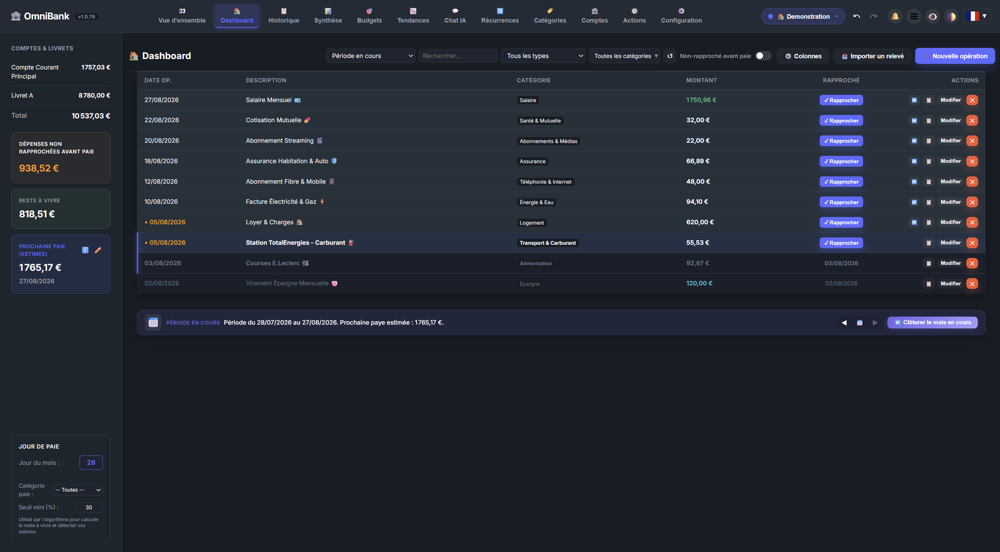

# 📊 Page Documentation: Cockpit, Dashboard and Ledger

OmniBank Local offers three complementary views of the current cycle (from one payday to the next):

| View | Purpose | Access |
|---|---|---|
| **🎛️ Cockpit** | The essentials at a glance: remaining budget, reconciled spending, spending pace. The app's **home screen**. | Main menu, logo click, mobile tab |
| **📊 Dashboard** | The detailed version: balances, averages, operations to reconcile, trends. | Main menu, mobile tab |
| **📒 Ledger** | The cycle's list of operations, to enter, reconcile and filter. | Main menu, "More" menu on mobile |

The Cockpit and the Dashboard are always available: they cannot be disabled in Configuration.

---

## 📸 Illustrations

*The Ledger: the cycle's operations, balances and reconciliation.*

*Modal for quickly creating a new transaction.*

---

## 🎛️ 1. The Cockpit

A simplified view for a quick daily check:
- **Remaining budget**: ring gauge of the share left and amount left out of the cycle's initial remaining budget.
- **Reconciled spending**: share of expected expenses already reconciled, and what is still to come.
- **Spending pace (€/day)**: needle gauge comparing your daily spending to your average, with a verdict (e.g. "On track").
- **End-of-cycle projection**: forecast balance at the next payday.
- **Auto-Pilot** and **To reconcile**: Auto-Pilot status, operations to review and number of operations awaiting reconciliation (one click opens the Ledger).
- **Next month outlook**: expected income, fixed charges, estimated variable spending and estimated net margin, with a link to the Simulator.

## 📊 2. The Dashboard

The full view of the same data, for deeper analysis:
- **Summary cards**: net worth, remaining budget, end-of-cycle projection, next payday.
- **Averages & pace**: average income, fixed expenses, variable expenses and net balance, over an adjustable period (1 week to all history) and per month, week, day or hour.
- **Operations to reconcile**: filterable list (past, expenses, income), one-click reconciliation or batch reconciliation of past due items.
- **Trend chart** of balance evolution.

Both the Cockpit and the Dashboard header offer an account selector, the Auto-Pilot status and the **New transaction** button.

## 📒 3. The Ledger

The current cycle's list of operations, the everyday working tool:
- **Columns**: date, description, category, amount, reconciliation and actions; more columns (accounts, envelope, recurrence, attachments…) can be enabled with the **Columns** button.
- **Filters**: search, period, type, category and "Unreconciled before pay".
- **Actions**: **Import statement**, **Fetch online** (when a bank is connected), **Automations** and **New transaction**. On mobile, the first three are in the **⋯** menu, the filters sit behind the **Filters** button (showing how many are active) and **New transaction** is the round **＋** button at the bottom right. History works the same way.
- **Reconciliation**: a **Reconcile** button on each operation; reconciled operations are dimmed and show their reconciliation date.
- **Period bar**: navigate between cycles (◀ 📅 ▶) and **Close current month**. On desktop it sits at the bottom of the list; on mobile it opens in the header from the **📅 Period** button.

To browse every operation across all periods, use **History**.

## ➕ 4. Quick Entry (New transaction)

The **New transaction** button opens the creation modal:
- **Account(s)**: "From" and/or "To" depending on direction (expense, income or transfer).
- **Amount** and **date**.
- **Description** and **category**.
- **Reconciliation status**: checked or not.

## 🤖 5. Auto-Pilot Widget

The Cockpit and the Dashboard show the Auto-Pilot status:
- **Live status**: active or on standby.
- **Operations to review**: number of decisions awaiting your review.
- **Quick access to the Auto-Pilot Control Center**.

## 🧭 6. Navigation and Header Controls

- **On desktop**: horizontal menu at the top of the screen.
- **On mobile**: tab bar at the bottom of the screen (Cockpit, Dashboard, Auto-Pilot, AI Chat when enabled, and **More** for every other view).
- **Undo / Redo**: ↩️ / ↪️ (or `Ctrl+Z` / `Ctrl+Y`) to undo or redo any accounting action.
- **Notification center (🔔)**: budget alerts, AI reports and due-date reminders.
- **Profile switcher**: switch between your profiles (e.g. *Personal finances*, *Association*).
- **Privacy mode (👁️)**: hides amounts (`••• €`) in public places.
- **Themes**: Classic dark and light, Titanium dark and Alabaster light.

---

## 💡 Tips & Best Practices

> [!TIP]
> Start the day on the Cockpit: the remaining budget and the spending pace tell you at a glance where you stand. Then move to the Ledger to reconcile new operations.
