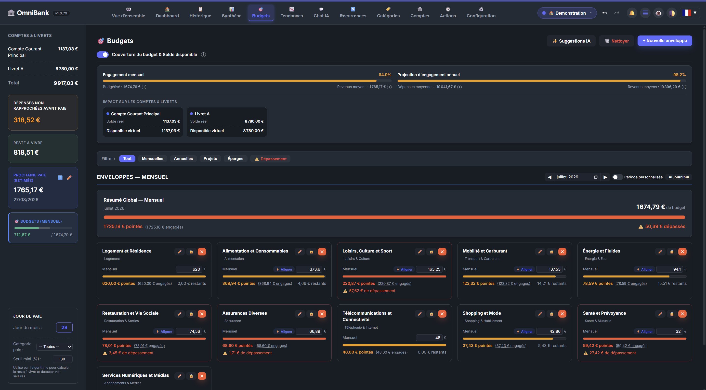
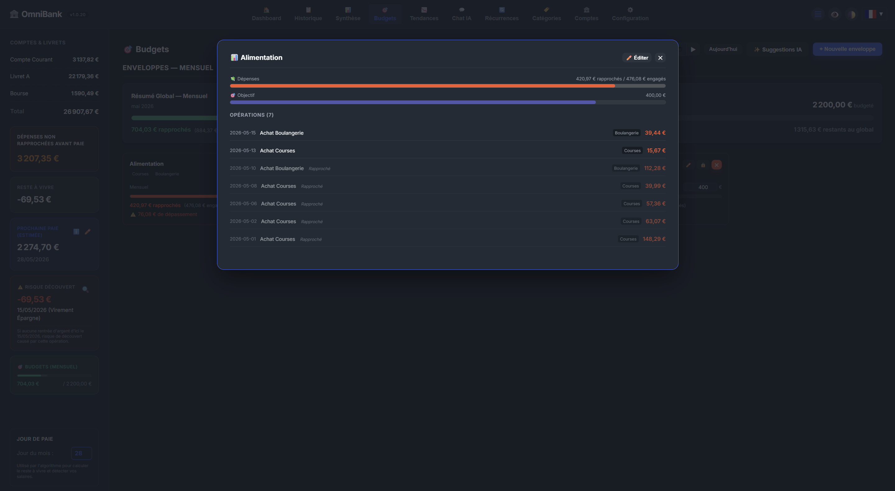
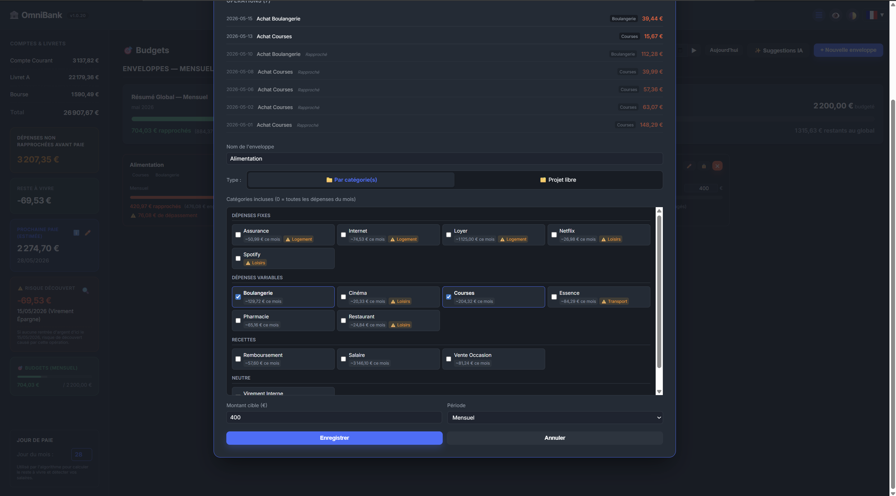
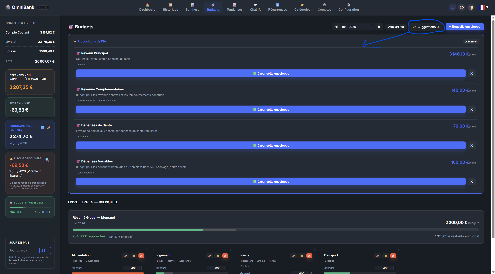

# 🎯 Page Documentation: Budgets, Envelopes & Auto-Pilot

The **Budgets** page tracks day-to-day spending using the **budget envelope method**. It opens on pending suggestions, the current period and a one-line summary of what needs attention. The **budget Auto-Pilot** spots categories without an envelope and limits worth reviewing, using the built-in engine or a local AI.

---

## 📸 Illustrations

*General overview of budget envelopes.*

*Detailed view of an envelope's consumption and associated transactions.*

*Editing and locking a budget envelope.*

*Budget suggestions.*

---

## 🛠️ Tracking Your Envelopes

### 1. The Envelope Method
An envelope is a **spending limit** assigned to one or more categories (e.g. *Groceries*, *Transport*). An expense counts in a single envelope: a category already tracked by another envelope over the same period cannot be added, and a spending envelope needs at least one category.

### 2. Periods and Groups
- **Personal mode:** monthly envelopes follow your **pay cycle**, like the Cockpit, not the calendar month.
- **Organisation mode:** nothing depends on pay, envelopes are grouped by account and finished ones move to the end of the list.
- **Groups:** each group (pay cycle, yearly, long term…) starts with its total, the same as in the sidebar, then lists its envelopes as compact rows sorted by urgency. Yearly envelopes are viewed year by year.
- **Planned charges:** envelopes whose spending mostly comes from your recurring transactions are grouped here, collapsed. They are left out of totals by default, and an option adds them back.

### 3. Reading an Envelope
Each row shows **spent to date** against the limit, transactions still **planned**, an **expected pace** marker and a plain status ("57.74 € over", "98.47 € left").

A **notification** is sent when an envelope reaches 90% and when it goes over, once per envelope and period.

### 4. Detail and Editing
Clicking an envelope opens its detail: the gauge, then its transactions, with a "planned" tag on upcoming ones.
- **Edit:** while editing, the right column shows the transactions tracked by the checked categories, updated at each change. Categories already tracked by another envelope are gathered at the end of the list and cannot be checked.
- **Use as limit:** takes the categories' usual spending (average over the last 12 months).
- **Raise to …:** offered only when the envelope is over its limit.
- **Pin:** shows the envelope at the top of the sidebar.
- **Lock (`🔒`):** Auto-Pilot no longer suggests any limit change for this envelope, and it no longer follows recurring charges.

### 5. The Tools Menu
- **Automations:** budget Auto-Pilot settings.
- **Envelope suggestions:** the suggestions side panel.
- **Customize display:** pinned envelopes, displayed totals and short names in the sidebar.
- **Delete several envelopes…:** one choice per group, nothing checked at first, the total on the button and a warning for piggy bank deposits. "Undo" restores everything at once: envelopes, categories, deposits and pending suggestions.

### 6. Updates Without Reloading
Changes appear without reloading the page. Envelopes and suggestions added by the background analysis also appear on the open page, about ten seconds later. The update waits while you are typing or a window is open.

---

## 🧭 The Suggestions Panel

**Tools > Envelope suggestions** opens a panel next to your envelopes. Suggestions from the built-in engine appear immediately, with a summary line: what they cost per month and what remains of your pay or income.

- **Three groups:** additions to your envelopes, limits to review, new envelopes. Each suggestion shows its categories, an editable amount and a few example transactions.
- **Refine with AI:** optional, and shown only when an AI is configured. When it does not answer, suggestions are clearly presented as coming from the built-in engine.
- **Adjust the amounts:** three plain levels (tight, usual, with headroom).
- **Dismiss:** removes a suggestion. You can find it in the history and reactivate it from there.
- **Main button:** it says what it will do ("Create 3 and complete 1"). The page then scrolls to the changed envelopes and highlights them.

"Review" on the Auto-Pilot banner and the "Suggested limit" badge on an envelope open this same panel.

---

## 🤖 The Budget Auto-Pilot

Its settings are in **Tools > Automations**.

### When Does the Analysis Run?
- **Continuously:** about once a minute, the background analysis looks for new regular categories and checks envelope alerts.
- **At each new period** (pay cycle, or month in organisation mode): it spots the limits to review.
- **On startup:** first analysis about 15 seconds after launch, catching up if a period was missed.
- **On demand:** with the **Run analysis now** button.

### The Engine
- **Deterministic (default):** works with no AI and no network connection.
- **AI-assisted:** reads the meaning of categories to form groups. If it does not answer, the deterministic engine takes over.

### Part A: Categories Without an Envelope

1. **Addition to an existing envelope:** a category that fits an envelope is suggested as an addition, and the limit grows by the suggested amount, starting from the current limit. Never into a planned-charges envelope.
2. **New envelope:** related categories are grouped into a coherent envelope.
3. **Free spending only:** planned charges, such as a loan or a subscription, are already tracked by your recurring transactions and are flagged separately.
4. **🛡️ At least 2 months of spending:**
   > [!IMPORTANT]
   > A category is only auto-created, or suggested with high confidence, with spending in **at least 2 distinct months**. A monthly envelope created for a one-off purchase would lower your Remaining Budget every month for no reason.
5. **Dismissed suggestions:** a dismissed category is not suggested again, unless you reactivate it from the history.

**Auto-create without confirmation:** this option directly creates envelopes for the regular categories detected, including pending suggestions. A message at the top of the page lists what was created until you click "Got it". A category you remove from an envelope comes back as a simple suggestion.

### Part B: Limits to Review

A limit is a target: it does not follow spending month after month. Auto-Pilot suggests a new limit only if a monthly envelope was **exceeded**, or **less than 60% used**, in each of the **last 3 completed periods**.

- **Suggested amount:** the median spending of these 3 periods, rounded up to €5.
- **Minimum gap:** no suggestion if the gap is under €5 or under 5% of the limit.
- **Frequency:** once per period. Unhandled suggestions from the previous period are replaced.
- **Approval:** a suggested limit is **never applied on its own**.
- **Exclusions:** piggy banks, projects, yearly or dated envelopes, locked envelopes, fixed-charge envelopes.

### Limits That Follow Recurring Charges
With this option, when the amount of a recurring charge changes, the limit of the monthly or yearly envelope that tracks it adjusts in proportion to the charge's frequency. Dated envelopes, projects, piggy banks and locked envelopes are not affected.

### Messages After an Analysis
- *"No adjustment or new envelope needed at the moment"*: your limits match your spending, and spending outside envelopes does not meet the conditions yet.
- *"{count} budget recommendation(s) identified"*: suggestions are waiting in the suggestions panel.

---

## 🔒 Traceability

- **Local data:** the built-in engine runs entirely on your server.
- **Audit log:** each suggestion issued, applied or dismissed is timestamped and kept in the profile's database with its full snapshot. Applied actions can be undone.
