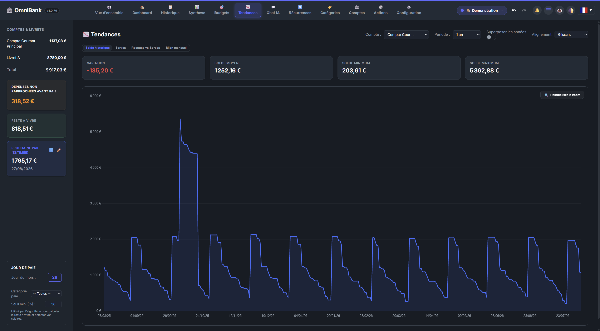

# 📉 Page Documentation: Trends & Graphical Analytics

The **Trends** page tracks medium and long-term financial evolution using advanced interactive charts.

---

## 📸 Illustration

*Interactive chart plotting income, expenses, and net balance over multiple months.*

---

## 🛠️ Components & Features

### 1. Multi-Month Evolution Charts
- **Income vs Expense Curves**: View parallel trends of income and expenses month by month over past years.
- **Net Balance Histogram**: Spot deficit months (red bars) and surplus months (green bars) instantly.

### 2. Filters & Time Window Selectors
- **Time Window**: 3 months, 6 months, 12 months, or custom year ranges.
- **Account Filter**: Compare savings account growth against checking account usage.
- **Category Filter**: Track curve trends for a specific expense category (e.g., utility bills over 12 months).

### 3. Trend Metrics
Calculated summary metrics display average monthly spending, peak spending periods, and percentage shifts between consecutive time windows.

### 4. Averages & Pace
Average income, fixed expenses, variable expenses and net balance for the selected account, over an adjustable period (1 week to all history), shown per month, week, day or hour.

### 5. Top 6 Expenses of the Month
The six most expensive categories of the current month (all, fixed or variable). Clicking a category opens its operations in History.
