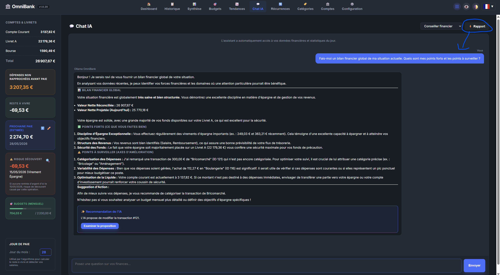
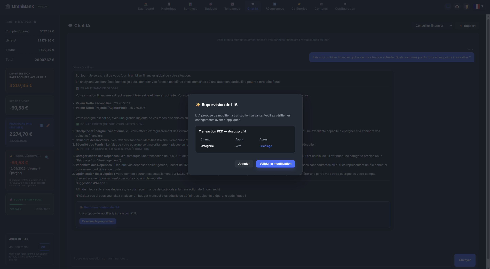

# 🤖 Page Documentation: Local AI Chat (Ollama)

The **AI Chat** page provides a natural language conversational interface with your autonomous financial assistant. It operates 100% offline on your device via **Ollama**.

---

## 📸 Illustrations

*Conversational AI chat interface with chat history and model selector.*

*Autonomous action proposal by AI (Function Calling with confirmation card).*

---

## 🛠️ Components & Features

### 1. Natural Language Financial Queries
Ask financial questions or request tailored insights:
- *"What was my biggest expense category last month?"*
- *"How much is left in my groceries budget?"*
- *"Can I afford to save $200 this month?"*

### 2. Recommended Models
The setup wizard (AI step) and **Configuration > AI Assistant** suggest three models. "Use" picks the model and sets its temperature and context; with Ollama, "Download" fetches it without the command line.

| Tier | Model | Graphics memory | Advisor answer | Download |
|---|---|---|---|---|
| Minimum | `gemma4:e4b` | about 5.4 GB | about 3.4 s | 6.6 GB |
| Recommended | `bonsai-2:27b` | about 9.5 GB | about 14.6 s | 8.3 GB |
| Top quality | `gemma4:31b` | about 22.2 GB | about 13.8 s | 20.4 GB |

Settings applied: temperature 0.2 and 32K context for all three.

This choice comes from a benchmark of 9 models on OmniBank's own tasks: categorising the labels of a real statement, naming and categorising made-up labels, placing categories into envelopes, and twenty questions to the advisor (right tools, exact figures, nothing made up, answer in your language). Times were measured on a 24 GB graphics card; without a graphics card, expect several times longer.

- **Minimum**: fits an 8 GB card and answers fastest; the advisor gets hard questions wrong more often.
- **Recommended**: the quality of a 27-billion-parameter model in about 9 GB, thanks to ternary weights. It answered all twenty advisor questions correctly in every run, but files real-statement labels less well than the larger models.
- **Top quality**: the best score measured, for a 24 GB graphics card.

#### How these models were chosen
The same figures are shown in **Configuration > AI Assistant**, under the three cards. 9 models tested from 9 to 11 November 2026 on OmniBank's tasks, each task run three times, temperature 0.2, 32K context, RTX 3090 graphics card. The score out of 10 measures quality only and puts everyday work first: real statement 35% (category of 120 real labels), labels 25% (45 made-up labels), envelopes 25% (92 categories to place in 13 situations, 97 checks), advisor 15% (20 questions on a demo profile: right tools, exact figures, nothing made up; questions with figures are also replayed 7 times). The advisor weighs little in the score, but a model that gets it wrong too often is not chosen. Speed and memory do not count in it. The 7 other models of the first benchmark (6 November), all set aside then, were not measured again.

| Model | Rank | Score /10 | Real statement /120 · 35% | Labels /45 · 25% | Envelopes /97 · 25% | Advisor /20 · 15% | Minimum card | Memory | Answer |
|---|---|---:|---:|---:|---:|---:|---:|---:|---:|
| `gemma4:31b` | Top quality | **8.9** | 87 | 44 | 95 | 20 | 24 GB and more | 22.2 GB · Q4 | 13.8 s |
| `qwen3.8:27b` |  | 8.6 | 77–82 | 44 | 92–93 | 20 | 24 GB and more | 18.7 GB · Q4 | 11.4 s |
| `bonsai-2:27b` | Recommended | **8.3** | 71–72 | 42 | 93–94 | 20 | 12 GB | 9.5 GB · Q2 | 14.6 s |
| `gemma4:12b` |  | 8.3 | 75–76 | 44 | 91–92 | 17–18 | 12 GB | 9.1 GB · Q4 | 6.4 s |
| `gemma4:e4b` | Minimum | **8.0** | 67–69 | 42 | 90 | 16–19 | 8 GB | 5.4 GB · Q4 | 3.4 s |
| `nemotron-3.5-bolt:e4b` |  | 7.9 | 68–70 | 41 | 88–89 | 16–19 | 12 GB | 7.9 GB · Q4 | 5.2 s |
| `mimo-v2.6:9b` |  | 7.7 | 69 | 40 | 82–86 | 17–18 | 8 GB | 7.0 GB · Q4 | 6.5 s |
| `qwen3.5:9b` | Not chosen · real statement 57/120 | 7.3 | **57–63** | 36–37 | 85–87 | 17–19 | 8 GB | 7.0 GB · Q4 | 6.4 s |
| `qwen3.5:4b` | Not chosen · real statement 57/120 | 7.1 | **57–59** | 38 | 74–77 | 17–18 | 8 GB | 4.5 GB · Q4 | 5.2 s |

Precision: one question is worth at most 0.075 points in the score (an advisor question). Within 0.3 points and 4 questions per task, two models cannot be told apart.

- **Not chosen**: fewer than 15 right answers out of 20 from the advisor (75%), or a task under half its score, in any of the three runs. The task at fault is shown in the Rank column and in bold.
- Top quality: the best score among models that answer in under 20 s. Alternative: the best score with no time limit. Minimum and Recommended: the models advised for small and medium cards, below.
- Two models are tied when their scores are within 4 advisor questions of each other and every task differs by at most 4 questions per run; the lighter one then wins. So `gemma4:e4b` (5.4 GB) and `nemotron-3.5-bolt:e4b` (7.9 GB) are tied. `bonsai-2:27b` and `gemma4:12b` are not, despite the same score: 4 real-statement labels separate them in every run, and the better score wins.
- Memory: used on the graphics card once the model is loaded, measured with nvidia-smi; Ollama's default version (quantisation shown when known), 32K context, 8-bit context cache (q8_0) with flash attention. With Ollama's default cache (16-bit), allow up to 0.5 GB more. Answer: the advisor's median time.

##### Your graphics card → advised model
| Graphics card | Advised model |
|---|---|
| 8 GB | `gemma4:e4b` |
| 12 GB | `bonsai-2:27b` |
| 16 GB | `bonsai-2:27b` |
| 24 GB and more | `gemma4:31b` |

A model fits a card if its memory is at most the card's size minus 1 GB. A model that is too big still works, partly in system memory, but much more slowly.

##### And the recommended settings
- 32K context: the advisor's instructions and tools already take about 9,000 tokens. 16K is the minimum accepted; 32K leaves room for the conversation history and large imports.
- Temperature 0.2: the benchmark value. It only sets the advisor and budget suggestions; categorisation and import always stay at 0.1.
- Thinking kept for the advisor (benchmark of 8 November 2026): without it, `gemma4:e4b` stops calling its tools and drops from 9 to 2 or 3 right answers out of 12, and `bonsai-2:27b` loses up to two. `qwen3.8:27b` loses nothing and answers in 7 to 8 s instead of 12: the switch in Configuration > AI Assistant > Advanced settings turns it off. The other AI tasks never think.

Any other installed model stays available in the dropdown. Prefer a model that can call tools: the advisor and data extraction need it.

### 3. Autonomous Function Calling Cards
When asking the AI to perform a management action (e.g., *"Add a $45 grocery expense today"*, *"Prepare a €280 bridge transfer from my Savings account to my Checking account"*, or *"Trigger a bank synchronization"*), the AI never mutates your database without explicit consent:
1. It prepares the structured tool function request:
   - `create_transaction`: Manual expense or income recording.
   - `create_planned_transfer`: Recording an unreconciled planned transfer between two of your accounts.
   - `set_budget`: Adjusting a category budget envelope ceiling.
   - `trigger_bank_sync`: Initiating an online statement fetch for configured bank connections.
2. The UI renders an interactive **Action Confirmation Card** with detailed arguments.
3. You approve the action by clicking **"Confirm"** (or cancel), keeping full manual control.

### 4. Bridge Transfers & Banking Boundaries (Strictly Offline & Read-Only)
OmniBank and its AI assistant adhere to a strict operational principle: **no external banking write operations are possible**.
- The application connects to financial institutions strictly in **read-only mode**. Neither the AI nor the app can move real funds or issue external wire transfers.
- When facing a cash shortfall or overdraft risk, the assistant guides you through a clear **3-step workflow**:
  1. **User Real Bank Transfer**: You execute the actual transfer on your bank's native mobile app or web portal.
  2. **OmniBank Planned Transfer Recording**: The assistant offers to immediately log this planned transfer in OmniBank (`create_planned_transfer`). Once approved, this instantly updates your projected balance and Reste à Vivre (RTL).
  3. **Automatic Statement Reconciliation**: Once your bank clears the transfer, the next online statement sync (triggered via the AI's `trigger_bank_sync` tool, manually, or via Auto-Pilot) automatically detects and reconciles the real bank transaction against your planned entry with zero duplication.

---

## 🔒 Data Privacy Guarantee

> [!IMPORTANT]
> No financial records, description labels, or monetary values leave your computer. RAG prompts are sent strictly to the local Ollama instance on `127.0.0.1`.
