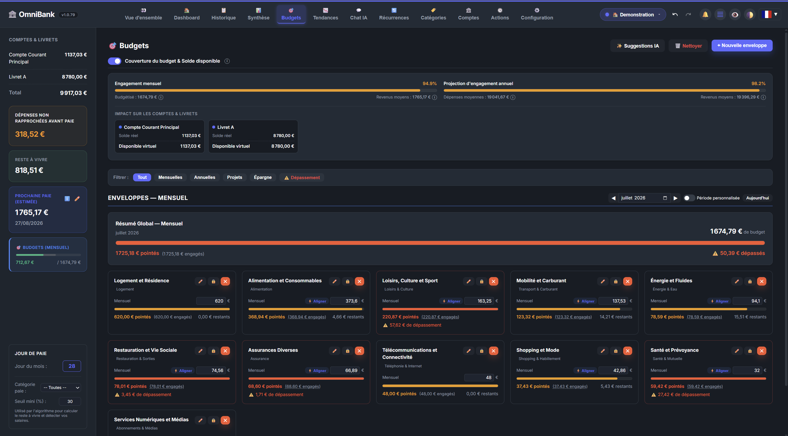
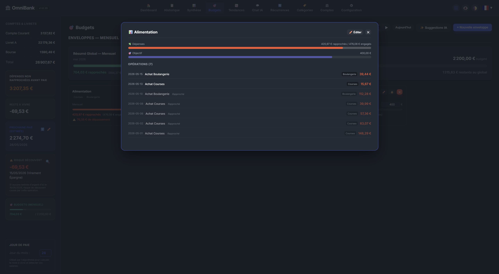
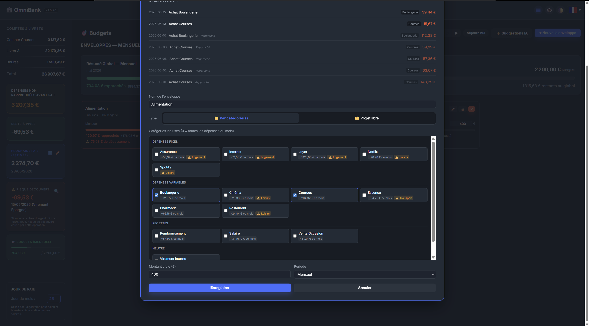
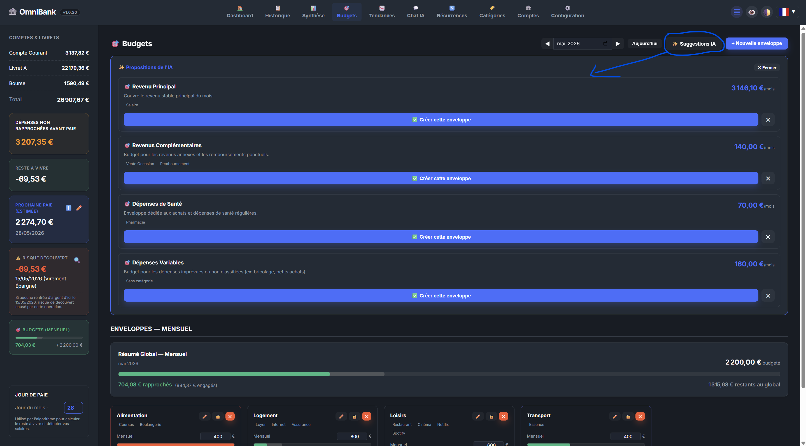

# 🎯 Documentation Page : Budgets, Enveloppes & Auto-Pilote

La page **Budgets** sert à suivre ses dépenses au quotidien selon la méthode des **enveloppes budgétaires**. Elle s'ouvre sur les suggestions en attente, la période en cours et une ligne qui résume ce qui demande attention. L'**Auto-Pilote budgétaire** repère les catégories sans enveloppe et les plafonds à revoir, avec le moteur intégré ou une IA locale.

---

## 📸 Illustrations

*Vue d'ensemble des enveloppes budgétaires.*

*Détail de la consommation d'une enveloppe et liste des dépenses associées.*

*Modification et verrouillage d'une enveloppe budgétaire.*

*Propositions budgétaires.*

---

## 🛠️ Suivre ses enveloppes

### 1. La méthode des enveloppes
Une enveloppe est un **plafond de dépense** attribué à une ou plusieurs catégories (ex : *Alimentation & Courses*, *Mobilité & Transports*). Une dépense ne compte que dans une seule enveloppe : une catégorie déjà suivie par une autre enveloppe sur la même période ne peut pas y être ajoutée, et une enveloppe de dépenses doit avoir au moins une catégorie.

### 2. Périodes et groupes
- **Mode personnel :** les enveloppes mensuelles suivent votre **cycle de paie**, comme le Cockpit, et non le mois calendaire.
- **Mode organisation :** rien ne dépend de la paie, les enveloppes sont regroupées par compte et celles qui sont terminées passent en fin de liste.
- **Groupes :** chaque groupe (cycle, annuelles, long terme…) commence par son total, le même que dans la barre latérale, puis présente ses enveloppes en lignes compactes triées par urgence. Les enveloppes annuelles se consultent année par année.
- **Charges prévues :** les enveloppes dont l'essentiel des dépenses vient de vos récurrences y sont regroupées, repliées. Elles ne comptent pas dans les totaux par défaut, et une option permet de les réintégrer.

### 3. Lire une enveloppe
Chaque ligne indique le **dépensé à ce jour** face au plafond, les opérations encore **prévues**, un repère du **rythme attendu** et un état en clair (« Dépassée de 57,74 € », « Reste 98,47 € »).

Une **notification** est envoyée quand une enveloppe atteint 90 %, puis quand elle est dépassée, une seule fois par enveloppe et par période.

### 4. Détail et modification
Cliquer sur une enveloppe ouvre son détail : la jauge, puis ses opérations, avec la mention « prévue » pour celles à venir.
- **Modifier :** pendant la modification, la colonne de droite montre les opérations que suivent les catégories cochées, mises à jour à chaque changement. Les catégories déjà suivies par une autre enveloppe sont rassemblées en fin de liste et ne peuvent pas être cochées.
- **Reprendre comme plafond :** reprend la dépense habituelle des catégories (moyenne des 12 derniers mois).
- **Relever à … :** proposé seulement quand l'enveloppe est dépassée.
- **Épingler :** affiche l'enveloppe en tête de la barre latérale.
- **Verrouiller (`🔒`) :** l'Auto-Pilote ne propose plus aucun changement de plafond pour cette enveloppe, et elle ne suit plus les récurrences.

### 5. Le menu Outils
- **Automatismes :** réglages de l'Auto-Pilote budgétaire.
- **Suggestions d'enveloppes :** panneau latéral de propositions.
- **Personnaliser l'affichage :** enveloppes épinglées, totaux affichés et noms courts dans la barre latérale.
- **Supprimer plusieurs enveloppes… :** un choix par groupe, rien de coché au départ, le total sur le bouton et un avertissement pour les dépôts des tirelires. « Annuler » restaure tout d'un coup : enveloppes, catégories, dépôts et suggestions en attente.

### 6. Mise à jour sans rechargement
Les changements s'affichent sans recharger la page. Les enveloppes et propositions ajoutées par l'analyse de fond apparaissent aussi sur la page ouverte, une dizaine de secondes plus tard. La mise à jour attend si vous êtes en train de saisir ou si une fenêtre est ouverte.

---

## 🧭 Le panneau de suggestions

**Outils > Suggestions d'enveloppes** ouvre un panneau à côté de vos enveloppes. Les propositions du moteur intégré s'affichent aussitôt, avec une ligne de synthèse : ce qu'elles coûtent par mois et ce qu'il reste sur votre paie ou vos recettes.

- **Trois groupes :** ajouts à vos enveloppes, plafonds à revoir, nouvelles enveloppes. Chaque proposition montre ses catégories, un montant modifiable et quelques exemples d'opérations.
- **Affiner avec l'IA :** facultatif, et affiché seulement si une IA est configurée. Quand elle ne répond pas, les propositions sont clairement présentées comme venant du moteur intégré.
- **Ajuster les montants :** trois niveaux en clair (au plus juste, habituel, avec marge).
- **Écarter :** retire une proposition. Vous la retrouvez dans l'historique, d'où elle peut être réactivée.
- **Bouton principal :** il dit ce qu'il va faire (« Créer 3 et compléter 1 »). La page défile ensuite jusqu'aux enveloppes modifiées et les met en évidence.

« Examiner » dans le bandeau de l'Auto-Pilote et la pastille « Plafond proposé » d'une enveloppe ouvrent ce même panneau.

---

## 🤖 L'Auto-Pilote budgétaire

Ses réglages se trouvent dans **Outils > Automatismes**.

### Quand l'analyse s'exécute-t-elle ?
- **En continu :** environ chaque minute, l'analyse de fond cherche les nouvelles catégories régulières et vérifie les alertes d'enveloppes.
- **À chaque nouvelle période** (cycle de paie, ou mois en mode organisation) : elle repère les plafonds à revoir.
- **Au lancement :** première analyse environ 15 secondes après le démarrage, avec rattrapage si une période a été manquée.
- **À la demande :** avec le bouton **Lancer une analyse maintenant**.

### Le moteur
- **Déterministe (par défaut) :** fonctionne sans IA ni connexion réseau.
- **Assisté par IA :** analyse le sens des catégories pour former des regroupements. S'il ne répond pas, le moteur déterministe prend le relais.

### Volet A : catégories sans enveloppe

1. **Ajout à une enveloppe existante :** une catégorie qui a sa place dans une enveloppe y est proposée en ajout, et le plafond augmente du montant proposé, à partir du plafond actuel. Jamais dans une enveloppe de charges prévues.
2. **Nouvelle enveloppe :** les catégories proches sont regroupées dans une enveloppe cohérente.
3. **Dépenses libres uniquement :** les charges prévues, comme un prêt ou un abonnement, sont déjà suivies par vos récurrences et sont signalées à part.
4. **🛡️ Au moins 2 mois de dépenses :**
   > [!IMPORTANT]
   > Une catégorie n'est créée automatiquement, ou proposée avec une confiance élevée, qu'avec des dépenses sur **au moins 2 mois distincts**. Une enveloppe mensuelle créée pour un achat isolé réduirait votre Reste à Vivre chaque mois sans raison.
5. **Propositions écartées :** une catégorie écartée n'est plus reproposée, sauf si vous la réactivez depuis l'historique.

**Auto-création sans validation :** cette option crée directement les enveloppes des catégories régulières détectées, y compris les propositions en attente. Un message en tête de la page récapitule les créations jusqu'à ce que vous cliquiez sur « Compris ». Une catégorie que vous retirez d'une enveloppe revient comme simple proposition.

### Volet B : plafonds à revoir

Un plafond est un objectif : il ne suit pas la dépense mois après mois. L'Auto-Pilote propose un nouveau plafond seulement si une enveloppe mensuelle a été **dépassée**, ou **utilisée à moins de 60 %**, sur chacune des **3 dernières périodes terminées**.

- **Montant proposé :** la dépense médiane de ces 3 périodes, arrondie à 5 € au-dessus.
- **Écart minimal :** aucune proposition si l'écart est inférieur à 5 € ou à 5 % du plafond.
- **Fréquence :** une fois par période. Les propositions non traitées de la période précédente sont remplacées.
- **Validation :** une proposition de plafond n'est **jamais appliquée seule**.
- **Exclusions :** tirelires, projets, enveloppes annuelles ou datées, enveloppes verrouillées, enveloppes de charges fixes.

### Plafonds qui suivent les récurrences
Avec cette option, quand le montant d'une charge récurrente change, le plafond de l'enveloppe mensuelle ou annuelle qui la suit s'ajuste en proportion de la fréquence de la charge. Les enveloppes datées, les projets, les tirelires et les enveloppes verrouillées ne sont pas concernés.

### Les messages après une analyse
- *« Aucun ajustement ni nouvelle enveloppe nécessaire pour le moment »* : vos plafonds correspondent à vos dépenses, et les dépenses hors enveloppes ne remplissent pas encore les conditions.
- *« {count} recommandation(s) budgétaire(s) identifiée(s) »* : des propositions vous attendent dans le panneau de suggestions.

---

## 🔒 Traçabilité

- **Données locales :** le moteur intégré s'exécute entièrement sur votre serveur.
- **Journal d'audit :** chaque suggestion émise, appliquée ou écartée est horodatée et conservée dans la base du profil avec son instantané complet. Les actions appliquées peuvent être annulées.
