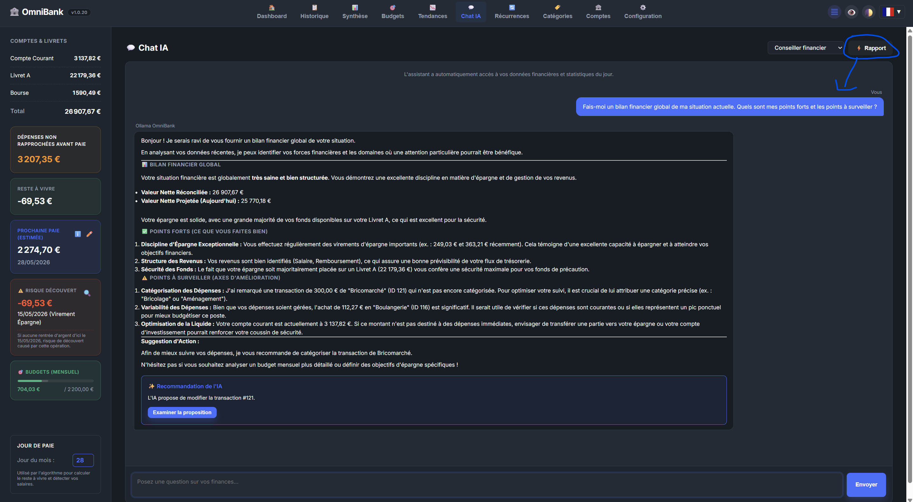
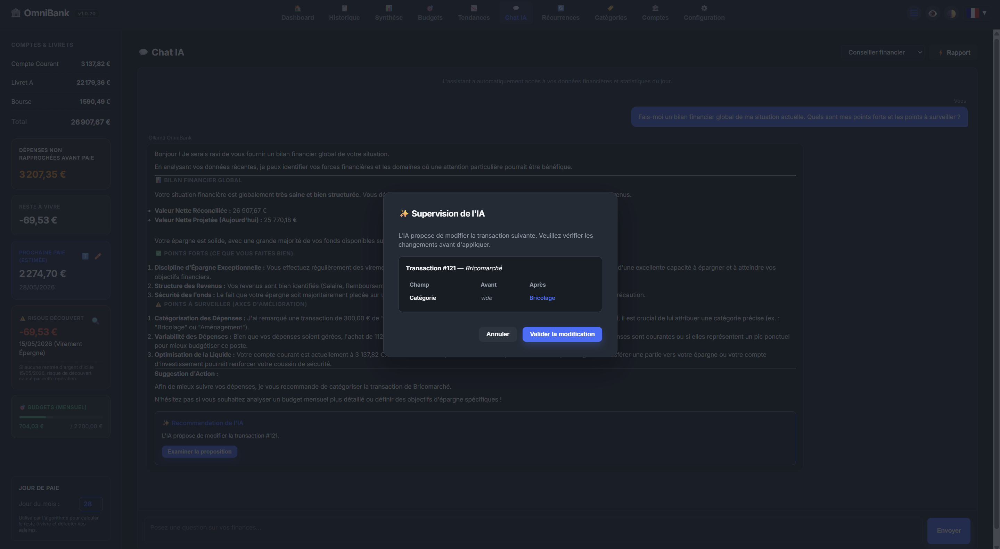

# 🤖 Documentation Page : Assistant Chat IA (Ollama Local)

La page **Chat IA** fournit une interface de dialogue naturelle avec votre conseiller financier personnel autonome. Il fonctionne entièrement hors-ligne sur votre machine via l'instance **Ollama**.

---

## 📸 Illustrations

*Interface du Chat IA conversationnel avec historique de discussion et sélecteur de modèle.*

*Proposition d'action automatique par l'IA (Function Calling avec carte de validation).*

---

## 🛠️ Composants & Fonctionnalités

### 1. Dialogue en Langage Naturel
Vous pouvez poser n'importe quelle question sur votre comptabilité ou demander des analyses personnalisées :
- *"Quel a été mon plus gros poste de dépense le mois dernier ?"*
- *"Combien me reste-t-il sur mon budget alimentation ?"*
- *"Est-ce que je peux me permettre d'économiser 200 € ce mois-ci ?"*

### 2. Modèles recommandés
L'assistant de démarrage (étape IA) et **Configuration > Assistant IA** proposent trois modèles. « Utiliser » choisit le modèle et règle sa température et son contexte ; avec Ollama, « Télécharger » le récupère sans passer par la ligne de commande.

| Niveau | Modèle | Mémoire graphique | Réponse du conseiller | Téléchargement |
|---|---|---|---|---|
| Minimum | `gemma4:e4b` | environ 3,5 Go | environ 5 s | 9,6 Go |
| Recommandé | `bonsai-2:27b` | environ 9,2 Go | environ 16 s | 8,3 Go |
| Top qualité | `qwen3.8:27b` | environ 17,5 Go | environ 13 s | 17,7 Go |

Réglages appliqués : température 0,2 et contexte 32K pour les trois.

Ce choix vient d'un banc d'essai de 16 modèles sur les tâches d'OmniBank : nom et catégorie de libellés bancaires, regroupement des catégories en enveloppes, et douze questions au conseiller (bons outils, chiffres exacts, rien d'inventé, réponse dans votre langue). Les temps ont été mesurés sur une carte graphique de 24 Go ; sans carte graphique, comptez plusieurs fois plus long.

- **Minimum** : tient sur presque toute carte graphique récente ; le conseiller se trompe plus souvent sur les questions difficiles.
- **Recommandé** : la qualité d'un modèle de 27 milliards de paramètres dans environ 9 Go, grâce à des poids ternaires. Il a répondu juste aux douze questions du conseiller, mais regroupe les enveloppes de façon moins régulière.
- **Top qualité** : le meilleur ensemble mesuré, pour une carte graphique de 24 Go.

#### Comment ces modèles ont été choisis
Les mêmes chiffres sont affichés dans **Configuration > Assistant IA**, sous les trois cartes. Banc du 6 novembre 2026 : 16 modèles, chaque tâche jouée deux fois, température 0,2, contexte 32K, carte RTX 3090. La note sur 10 ne mesure que la qualité et compte d'abord le travail de tous les jours : vrai relevé 35 % (catégorie de 120 libellés réels), libellés 25 % (45 libellés inventés), enveloppes 25 % (22 catégories à placer), conseiller 15 % (12 questions sur un profil de démonstration : bons outils, chiffres exacts, rien d'inventé). Le conseiller pèse peu dans la note, mais un modèle qui s'y trompe trop est écarté. La vitesse et la mémoire n'y comptent pas.

| Modèle | Rang | Note /10 | Vrai relevé /120 · 35 % | Libellés /45 · 25 % | Enveloppes /22 · 25 % | Conseiller /12 · 15 % | Carte minimale | Mémoire | Réponse |
|---|---|---:|---:|---:|---:|---:|---:|---:|---:|
| `gemma4:31b` | Alternative | **8,9** | 87 | 44 | 21 | 12 | 24 Go et plus | 21,3 Go · Q4 | 23 s |
| `qwen3.8:27b` | Top qualité | **8,5** | 78–80 | 44 | 20 | 12 | 24 Go et plus | 18,7 Go · Q4 | 13 s |
| `bonsai-2:27b` | Recommandé | **8,1** | 73–74 | 43 | 16–20 | 12 | 12 Go | 9,5 Go · Q2 | 16 s |
| `qwen3.6:27b` | trop lent | 8,0 | 69 | 41 | 20–21 | 11 | 24 Go et plus | 18,6 Go · Q4 | 40 s |
| `nemotron-3.5-bolt:e4b` | Non retenu · conseiller 8/12 | 7,9 | 68–69 | 41 | 22 | **8–10** | 12 Go | 7,9 Go · Q4 | 6 s |
| `gemma4:12b` | Non retenu · conseiller 7/12 | 7,9 | 72–74 | 44 | 20 | **7–10** | 12 Go | 9,1 Go · Q4 | 10 s |
| `mimo-v2.6:9b` |  | 7,8 | 69–70 | 40 | 20–21 | 9–11 | 8 Go | 7,0 Go · Q4 | 7 s |
| `gemma4:e4b` | Minimum | **7,8** | 64–66 | 41–42 | 21 | 9–10 | 8 Go | 4,9 Go · Q4 | 5 s |
| `qwen3.5:9b` | Non retenu · vrai relevé 59/120 | 7,6 | **59–61** | 38–40 | 20 | 11 | 8 Go | 7,0 Go · Q4 | 8 s |
| `qwen3.5:4b` | Non retenu · vrai relevé 57/120 | 7,4 | **57–58** | 38 | 19–20 | 11 | 8 Go | 4,5 Go · Q4 | 6 s |
| `ministral-3:14b` | Non retenu · conseiller 6/12 | 7,1 | 56–57 | 41 | 20–22 | **6** | 16 Go | 11,5 Go · Q4 | 5 s |
| `gemma4:e2b` | Non retenu · conseiller 6/12 | 7,0 | 54–60 | 42 | 18–19 | **6–8** | 8 Go | 3,5 Go · Q4 | 3,5 s |
| `bonsai-2:9b` | Non retenu · vrai relevé 53/120 | 6,9 | **53** | 34–35 | 16–20 | 10–12 | 8 Go | 4,2 Go · Q2 | 7 s |
| `ministral-3:8b` | Non retenu · conseiller 6/12 | 6,8 | 57–59 | 42 | 18 | **6** | 12 Go | 8,2 Go · Q4 | 2,2 s |
| `mistral-nemo` | Non retenu · conseiller 0/12 | 6,4 | 58 | 38 | 21 | **0–3** | 12 Go | 9,5 Go · Q4 | 1,4 s |
| `lfm3:1.7b` | Non retenu · vrai relevé 0/120 | 3,6 | **0** | 23 | 10 | 9–10 | 8 Go | 1,7 Go · Q4 | 12 s |

- **Non retenu** : moins de 9 bonnes réponses sur 12 au conseiller, ou une tâche sous la moitié de son score, sur l'une des deux passes. La tâche en cause est indiquée dans la colonne Rang et en gras.
- **Top qualité** : la meilleure note parmi les modèles qui répondent en moins de 20 s. **Alternative** : la meilleure note sans limite de temps. **Minimum** et **Recommandé** : les modèles conseillés pour les petites et les moyennes cartes, ci-dessous.
- À moins de 0,3 point d'écart, le modèle le plus léger l'emporte : deux passes ne permettent pas de départager plus finement. C'est ainsi que `gemma4:e4b` (4,9 Go) passe devant `mimo-v2.6:9b` (7,0 Go) sur une carte de 8 Go.
- Mémoire : occupée sur la carte graphique une fois le modèle chargé, mesurée avec nvidia-smi ; version par défaut d'Ollama (quantification indiquée quand elle est connue), contexte 32K, cache du contexte 8 bits (q8_0) avec flash attention. Avec le cache par défaut d'Ollama (16 bits), comptez jusqu'à 0,5 Go de plus. Réponse : temps médian du conseiller.

##### Votre carte graphique → modèle conseillé
| Carte graphique | Modèle conseillé |
|---|---|
| 8 Go | `gemma4:e4b` |
| 12 Go | `bonsai-2:27b` |
| 16 Go | `bonsai-2:27b` |
| 24 Go et plus | `qwen3.8:27b` |

Un modèle tient sur une carte si sa mémoire est au plus la taille de la carte moins 1 Go. Un modèle trop gros marche quand même, en partie en mémoire système, mais beaucoup plus lentement.

##### Et les réglages conseillés
- Contexte 32K : les consignes et les outils du conseiller occupent déjà environ 9 000 tokens. 16K est le minimum accepté ; 32K laisse la place à l'historique de la conversation et aux gros imports.
- Température 0,2 : la valeur du banc. Elle ne règle que le conseiller et les suggestions de budget ; la catégorisation et l'import restent toujours à 0,1.
- Réflexion gardée pour le conseiller (banc du 8 novembre 2026) : sans elle, `gemma4:e4b` n'appelle plus ses outils et tombe de 9 à 2 ou 3 bonnes réponses sur 12, et `bonsai-2:27b` en perd jusqu'à deux. `qwen3.8:27b` n'y perd rien et répond en 7 à 8 s au lieu de 12 : l'interrupteur de Configuration > Assistant IA > Réglages avancés permet de la couper. Les autres tâches de l'IA ne réfléchissent jamais.

Tout autre modèle installé reste disponible dans la liste déroulante. Préférez un modèle qui sait appeler des outils : le conseiller et l'extraction de données en ont besoin.

### 3. Modales d'Action Autonome (Function Calling)
Lorsque vous demandez à l'IA d'exécuter une tâche de gestion (ex: *"Ajoute une dépense de 45€ en supermarché aujourd'hui"*, *"Prépare un virement de précaution de 280 € de mon Livret A vers mon compte courant"*, ou *"Lance une synchronisation bancaire"*), l'IA ne modifie pas vos données sans votre accord :
1. Elle prépare la fonction d'action correspondante :
   - `create_transaction` : Saisie d'une dépense ou d'un revenu.
   - `create_planned_transfer` : Saisie d'un virement prévisionnel direct entre deux de vos comptes.
   - `set_budget` : Ajustement d'une enveloppe budgétaire.
   - `trigger_bank_sync` : Déclenchement d'un relevé en ligne de vos comptes bancaires synchronisés.
2. L'interface affiche une **Carte de Confirmation d'Action** interactive avec les détails précis.
3. Vous validez l'action en cliquant sur **"Confirmer"** (ou annulez), garantissant une sécurité et une maîtrise totales.

### 4. Virements de Précaution et Périmètre Bancaire (Strictement Hors-Ligne & Lecture Seule)
OmniBank et son assistant IA fonctionnent selon une règle fondamentale : **aucune action d'écriture bancaire réelle n'est possible**.
- L'application est strictement en **lecture seule** vis-à-vis des établissements bancaires. Ni l'IA ni l'application ne peuvent déplacer de l'argent réel sur vos comptes bancaires.
- Face à un besoin de trésorerie (ex. déficit de liquidité ou risque de découvert), l'assistant applique le workflow vertueux en **3 étapes** :
  1. **Réalisation bancaire réelle par l'utilisateur** : Vous effectuez le virement réel directement sur l'application ou le site sécurisé de votre banque.
  2. **Enregistrement prévisionnel dans OmniBank** : L'assistant vous propose de saisir immédiatement ce virement prévisionnel dans OmniBank (`create_planned_transfer`). Une fois validé, cela sécurise instantanément vos projections de solde et votre Reste à Vivre (RTL).
  3. **Rapprochement automatique** : Dès que l'opération est traitée par votre banque, le relevé bancaire en ligne (lancé via l'outil `trigger_bank_sync` de l'IA, manuellement, ou par l'Auto-Pilote) détecte l'écriture réelle et la rapproche automatiquement de la ligne prévisionnelle sans doublon.

---

## 🔒 Confidentialité des Données RAG

> [!IMPORTANT]
> Aucune donnée financière, aucun libellé et aucun montant ne sort de votre ordinateur. Les prompts d'analyse sont transmis uniquement au serveur Ollama local sur l'adresse `127.0.0.1`.
